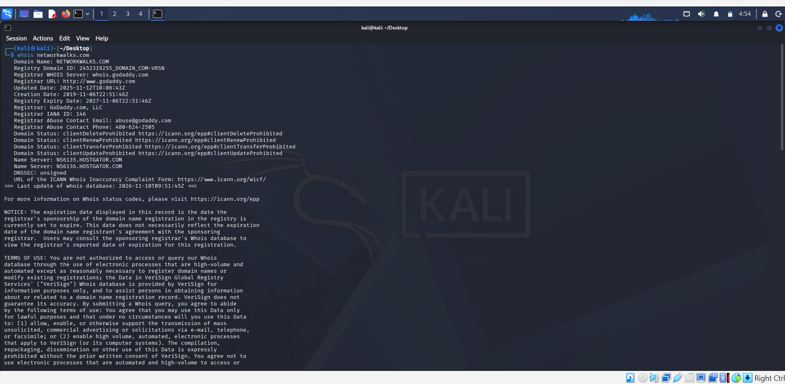
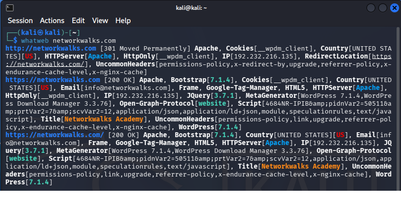
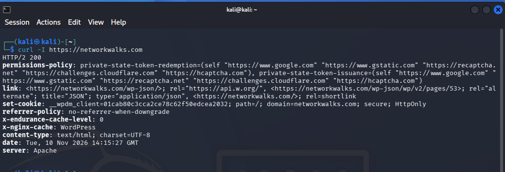

# NetworkWalks-Victor-B084-Cybersecurity-week2-Project
Footprinting and Reconnaissance Assessment
# 🔍 Footprinting and Reconnaissance Assessment

### Networkwalks Cybersecurity Internship | Week 2 Project

**Project Title:** Footprinting and Reconnaissance Attacks  
**Target Domain:** `networkwalks.com`  
**Operating System:** Kali Linux  
**Lab Environment:** Oracle VirtualBox  
**Assessment Type:** Footprinting, Web Fingerprinting and DNS Enumeration  
**Author:** Victor Kadiri  
**Date:** 10 November 2026

---

## 📌 1. Project Overview

This project was completed as part of my cybersecurity internship training at **Networkwalks Academy**.

The objective was to perform footprinting and reconnaissance on the authorised target domain, `networkwalks.com`, using six Kali Linux security tools.

Footprinting and reconnaissance are important stages of cybersecurity assessments because they help security professionals gather information about a target's infrastructure, technologies, domain registration and security controls.

The assessment combined publicly available information gathering with direct interaction with the authorised target website.

### 🎯 Project Objectives

- Identify the target domain's registration details.
- Discover the technologies powering the website.
- Resolve the domain name to its IP address.
- Examine HTTP response headers.
- Detect the presence of a Web Application Firewall (WAF).
- Enumerate publicly available DNS records.
- Document the findings and their security implications.

---

## 🛠️ 2. Tools and Technologies

| Tool | Purpose | Reconnaissance Activity |
|---|---|---|
| WHOIS | Domain registration lookup | Passive |
| WhatWeb | Website technology fingerprinting | Active |
| NSLOOKUP | Domain-to-IP resolution | DNS lookup |
| CURL | HTTP response header inspection | Active |
| WAFW00F | Web Application Firewall detection | Active |
| DNSRECON | DNS record enumeration | DNS reconnaissance |

**Testing Environment:** Kali Linux running in Oracle VirtualBox.

---

## 🔎 3. Practical Assessment and Findings

### Task 1: WHOIS — Domain Registration Information

**Objective:** Identify publicly available registration information about the target domain.

**Command executed:**

```bash
whois networkwalks.com
```

**Results:**

| Information | Findings |
|---|---|
| Domain Name | networkwalks.com |
| Registrar | GoDaddy.com, LLC |
| Registration Date | 6 November 2019 |
| Last Updated | 12 November 2025 |
| Expiration Date | 6 November 2027 |
| Nameserver 1 | ns6135.hostgator.com |
| Nameserver 2 | ns6136.hostgator.com |
| DNSSEC | Unsigned |
| Registrant | Registration Private |
| Privacy Provider | Domains By Proxy, LLC |

**Analysis:**

The WHOIS lookup revealed that the domain was registered through GoDaddy and uses HostGator nameservers.

The registrant's personal information was protected through a domain privacy service.

The result also indicated that DNSSEC was unsigned. DNSSEC helps protect DNS responses against certain forms of spoofing and tampering.

**Screenshot:**



**Key Learning:** WHOIS helps cybersecurity analysts identify domain registration details, registrars, nameservers and registration timelines.

---

### Task 2: WhatWeb — Website Technology Fingerprinting

**Objective:** Identify the web technologies used by the target website.

**Command executed:**

```bash
whatweb networkwalks.com
```

**Results:**

| Technology | Findings |
|---|---|
| Web Server | Apache |
| Content Management System | WordPress 7.1.4 |
| JavaScript Library | jQuery 3.7.1 |
| Additional Detected Component | Bootstrap 7.1.4 |
| WordPress Download Manager | 3.3.76 |
| IP Address | 192.232.216.135 |
| HTTP Redirect | 301 Moved Permanently |
| HTTPS Response | 200 OK |
| Website Title | Networkwalks Academy |
| Analytics Technology | Google Tag Manager |

*Note: These are the versions and technologies reported by WhatWeb. Fingerprinting results may require independent verification.*

**Analysis:**

The WhatWeb scan identified Apache as the web server and WordPress as the content management system.

It also detected jQuery, Bootstrap and WordPress Download Manager.

The website redirected HTTP traffic to HTTPS, indicating that the site supports encrypted connections.

Identifying web technologies is useful during security assessments because it helps analysts understand the target's technology stack and determine which components may require further security review.

**Screenshot:**



**Key Learning:** WhatWeb helps identify website technologies, frameworks, plugins and web server information.

---

### Task 3: NSLOOKUP — Domain-to-IP Resolution

**Objective:** Resolve the target domain name to its corresponding IP address.

**Command executed:**

```bash
nslookup networkwalks.com
```

**Results:**

```text
Server: 192.168.66.11
Address: 192.168.66.11#53

Non-authoritative answer:
Name: networkwalks.com
Address: 192.232.216.135
```

**Analysis:**

The NSLOOKUP command successfully resolved `networkwalks.com` to the IPv4 address `192.232.216.135`.

The DNS server used for the lookup was `192.168.66.11`.

The response was non-authoritative, meaning the DNS information was returned by a resolver rather than directly from an authoritative nameserver.

This demonstrates how the Domain Name System translates human-readable domain names into IP addresses used for network communication.

**Screenshot:**


**Key Learning:** NSLOOKUP is useful for DNS troubleshooting and identifying the IP addresses associated with domain names.

---

### Task 4: CURL — HTTP Response Header Inspection

**Objective:** Examine the HTTP response headers returned by the target website.

**Command executed:**

```bash
curl -I https://networkwalks.com
```

**Results:**

| HTTP Header | Observed Value |
|---|---|
| HTTP Status | HTTP/2 200 |
| Server | Apache |
| Content-Type | text/html; charset=UTF-8 |
| Referrer-Policy | no-referrer-when-downgrade |
| X-Nginx-Cache | WordPress |
| X-Endurance-Cache-Level | 0 |
| Cookie | __wpdm_client |
| Cookie Attributes | Secure; HttpOnly |

The response also included `permissions-policy` and `link` headers.

**Analysis:**

The HTTP response returned status code `200`, indicating that the server successfully processed the request.

The server identified itself as Apache.

The cookie included `Secure` and `HttpOnly` attributes, which provide useful security protections.

The `Secure` attribute restricts transmission of the cookie to secure connections, while `HttpOnly` prevents JavaScript from directly accessing the cookie.

The response also revealed information about caching and the WordPress API.

**Screenshot:**



**Key Learning:** CURL helps security analysts inspect server responses, identify HTTP headers and examine security-related configurations.

---

### Task 5: WAFW00F — Web Application Firewall Detection

**Objective:** Determine whether the target website is protected by a Web Application Firewall.

**Command executed:**

```bash
wafw00f https://networkwalks.com
```

**Results:**

```text
[*] Checking https://networkwalks.com

[+] The site https://networkwalks.com
    is behind ModSecurity (SpiderLabs) WAF.

[~] Number of requests: 2
```

**Analysis:**

WAFW00F detected a Web Application Firewall identified as **ModSecurity (SpiderLabs)**.

A Web Application Firewall helps protect websites by monitoring and filtering HTTP requests.

Depending on its configuration, a WAF can help defend against attacks such as SQL injection and cross-site scripting.

However, detecting a WAF does not automatically prove that the website is protected against every web application vulnerability.

**Screenshot:**


**Key Learning:** WAFW00F helps identify whether a website uses a Web Application Firewall and may reveal the technology providing that protection.

---

### Task 6: DNSRECON — DNS Enumeration

**Objective:** Enumerate DNS records associated with the target domain.

**Command executed:**

```bash
dnsrecon -d networkwalks.com
```

**Results:**

The scan returned the following notable information:

```text
INFO Starting enumeration for domain:
networkwalks.com

INFO std: Performing General Enumeration

ERROR No answer for DNSSEC query

ERROR The DNS operation timed out
while resolving SOA record.

INFO A networkwalks.com 192.232.216.135

INFO Enumerating SRV Records

ERROR No SRV Records Found

INFO Completed enumeration
```

**Analysis:**

DNSRECON successfully identified the domain's A record, confirming the IPv4 address `192.232.216.135`.

However, some DNS queries encountered errors, including a timeout when attempting to retrieve the SOA record.

No SRV records were found during the enumeration.

These results demonstrate that DNS enumeration may be affected by resolver timeouts, DNS server responses and network conditions.

The unsuccessful queries should not automatically be interpreted as security vulnerabilities.

**Screenshot:**


**Key Learning:** DNSRECON helps identify DNS records and understand the publicly visible DNS configuration of a domain.

---

## 📊 4. Summary of Findings

| Tool | Major Finding | Result |
|---|---|---|
| WHOIS | GoDaddy registrar; registration details identified | Successful |
| WhatWeb | Apache, WordPress and jQuery detected | Successful |
| NSLOOKUP | Resolved IP: 192.232.216.135 | Successful |
| CURL | HTTP/2 200; server headers identified | Successful |
| WAFW00F | ModSecurity WAF detected | Successful |
| DNSRECON | A record discovered; some DNS queries timed out | Partially Successful |

### Security Observations

**1. Domain registration privacy**

The domain uses a privacy service to conceal personal registrant details.

**2. Web technology disclosure**

The WhatWeb scan identified several technologies and reported their versions. Such information can help defenders maintain an accurate inventory of externally visible software.

**3. HTTPS configuration**

The website redirects HTTP requests to HTTPS, supporting encrypted communication.

**4. Web Application Firewall**

ModSecurity was detected, indicating the presence of an application-layer security control.

**5. DNS configuration**

The WHOIS results reported DNSSEC as unsigned. The DNSRECON results also showed incomplete enumeration due to DNS query errors.

These observations are reconnaissance findings, not confirmation of exploitable vulnerabilities.

---

## 🧠 5. Challenges Encountered

During the assessment, DNSRECON experienced difficulties retrieving certain DNS records.

The tool reported a DNS operation timeout when attempting to resolve the SOA record.

Despite this issue, it successfully identified the domain's A record.

**Lesson learned:** Reconnaissance tools may return incomplete results because of network conditions, resolver behaviour or server configuration. Analysts must distinguish tool errors from confirmed security weaknesses.

## 🎓 6. Skills and Knowledge Gained

Through this practical project, I developed a better understanding of:

- Domain footprinting and WHOIS investigations.
- Website technology fingerprinting.
- DNS resolution and enumeration.
- HTTP response header analysis.
- Web Application Firewall identification.
- Using Kali Linux reconnaissance tools.
- Interpreting technical results and documenting security findings.

I also gained practical experience working with command-line tools in a virtualised cybersecurity lab.

## 🏁 7. Conclusion

This project provided practical experience in footprinting and reconnaissance using six Kali Linux security tools.

The assessment successfully identified important information about the authorised target domain, including its registration details, web technologies, IP address, HTTP response headers and Web Application Firewall.

Although DNSRECON encountered some query errors, the exercise demonstrated how different reconnaissance tools complement one another during information gathering.

Overall, the project strengthened my understanding of the reconnaissance phase of cybersecurity assessments and the importance of documenting findings accurately.

## ⚖️ Ethical Disclaimer

This assessment was conducted for educational purposes as part of the Networkwalks cybersecurity internship, using the authorised target domain `networkwalks.com`.

The activities were limited to reconnaissance and information gathering. No exploitation, credential attacks or unauthorised access attempts were performed as part of the documented assessment.

**Author:** Victor Kadiri  
**Programme:** Networkwalks Cybersecurity Internship  
**Project:** Footprinting and Reconnaissance Attacks  
**Platform:** Kali Linux

*Learning cybersecurity through hands-on practice, ethical assessment and continuous improvement.*
